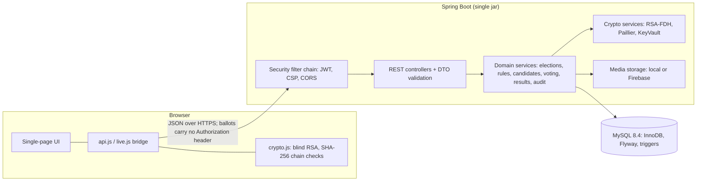
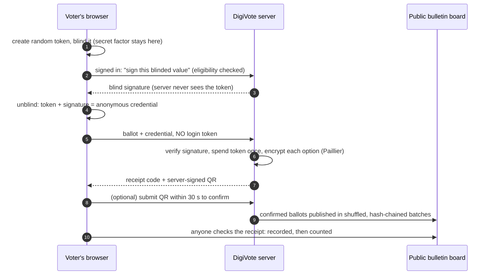

<div align="center">

# DigiVote

### Every vote secret. Every result provable.

**A verifiable, anonymous election platform for universities, companies, housing societies, NGOs and clubs.**

`Blind signatures` · `Homomorphic tally` · `Signed QR receipts` · `Hash-chained public bulletin board` · `Tamper-evident audit log`

    

</div>

---

## The idea

Most online voting asks you to trust somebody: the host, the admin, the database. DigiVote is built on the opposite
principle: **the system should not need your trust, because it can show its work.**

- Your ballot is **anonymous by construction**, not by promise: your browser gets a *blind-signed* credential, so the
  server proves you are eligible without ever seeing the token you vote with.
- Your vote is **encrypted** and tallied **homomorphically**: totals are decrypted, individual ballots never are.
- Your **receipt** lets you check, without logging in, that your ballot is on a public, hash-chained bulletin board and
  was counted in the result.
- Every administrative action lands in a **tamper-evident audit chain** that anyone with access can recompute from the
  first record, and so can the browser.

> *One eligible voter, one vote. Every accepted ballot independently checkable. Every action on the record.*

---

## Technology stack

| Layer | Technology | Used for |
| --- | --- | --- |
| **Runtime** | Java 21 (LTS) | records for immutable DTOs and value objects, enum-driven state machine, modern `switch` and pattern matching |
| **Application framework** | Spring Boot 3.5 · Spring MVC · Spring Validation | REST API, DTO records, Bean Validation, central `@RestControllerAdvice` error mapping |
| **Security** | Spring Security · OAuth2 Resource Server (Nimbus JOSE) · BCrypt (cost 12) | stateless HS256 JWT sessions, method-free authorization through one `AccessControlService`, per-organization lockout and password policy |
| **Persistence** | Spring Data JPA / Hibernate · HikariCP · MySQL 8.4 (InnoDB) | aggregates and repositories, row locks (`SELECT … FOR UPDATE`) as serialization points |
| **Schema management** | Flyway (14 versioned migrations) | schema, views, stored procedure, **append-only triggers**, reference data, anonymity hardening |
| **Cryptography** | Bouncy Castle · JCA (AES-256-GCM, HMAC-SHA256, SHA-256, SecureRandom) | RSA-FDH blind signatures, Paillier homomorphic encryption, key sealing, receipt and QR signing, hash chains |
| **API documentation** | springdoc-openapi (OpenAPI 3) | generated, importable API contract |
| **Optional cloud** | Firebase Admin SDK (Auth, Storage, Cloud Messaging, App Check) | federated sign-in and object storage; local-disk storage is the default |
| **Frontend** | Dependency-free ES2023 single-page app (hash router, no build step) | all role dashboards, served by the backend as static content |
| **Browser crypto** | `BigInt` modular arithmetic · Web Crypto (`SubtleCrypto`) | blinding and unblinding, SHA-256 chain verification, key-transparency checks |
| **Browser bridge** | `fetch` · `AbortController` · `sessionStorage` / `localStorage` | JWT handling, typed errors, per-feature hydrators, demo/live mode switch |
| **Build and delivery** | Maven · multi-stage Docker image · Docker Compose | single deployable jar that embeds the web app |
| **Testing** | JUnit 5 · Mockito · AssertJ · Spring Boot Test + MockMvc on real MySQL | unit, concurrency, anonymity-attack and database-trigger tests |
| **Legacy client** | React 19 · Vite · Tailwind CSS 4 | the earlier frontend, kept for reference and as the source of the browser crypto modules |

### Cryptographic building blocks

| Purpose | Primitive | Parameters |
| --- | --- | --- |
| Anonymous eligibility credential | RSA blind signature (Chaum) with a full-domain hash | 2048-bit modulus, e = 65537, FDH = MGF1-SHA256 over domain `DIGI-VOTE-FDH-v1` |
| Ballot secrecy and tally | Paillier additively homomorphic encryption | one ciphertext per option (encrypts 0 or 1); totals decrypted, ballots never |
| Key custody | AES-256-GCM key wrapping | purpose-bound AAD per key; master key from the environment |
| Receipt codes | HMAC-SHA256 → Crockford base32 | 100 bits + check character; only `SHA-256(code)` stored |
| QR confirmation | HMAC-SHA256 (derived subkey) | stateless 30 s window, no token or voter in the payload |
| Audit log | SHA-256 hash chain, canonical format v1 | per-organization chain, records and head protected by triggers |
| Bulletin board | SHA-256 hash chain | per-election genesis, shuffled batches (Fisher-Yates over `SecureRandom`) |
| Result binding | SHA-256 over election, method, ballot count, board head, per-option totals | recomputable by auditors and in the browser |
| Identity data at rest | AES-256-GCM seal + keyed HMAC for uniqueness | ID numbers sealed; proof scans encrypted before storage |
| Passwords | BCrypt | cost 12 |

## Architecture



**Design choices that carry weight**

- **Modular monolith** with one transactional boundary per use case; the ballot path is a single `READ_COMMITTED`
  transaction serialized per election by a row lock on the election-keys record.
- **Polymorphic roles.** Five role classes (`OrganizationOwnerUser`, `ElectionAdministratorUser`, `CandidateUser`,
  `VoterUser`, `AuditorUser`) expose permissions; roles are resolved from memberships on **every request**, so
  suspensions and role changes apply immediately and tokens carry no roles.
- **State machine** for the election lifecycle (Draft → Registration → Campaign → Voting → Verification → Published →
  Archived) with preconditions evaluated by a readiness service; the server is the only authority.
- **Strategy pattern** for counting (plurality, approval) and storage (local disk, Firebase), **decorator** for upload
  validation (declared type *and* magic bytes), **observer** for lifecycle events (manifesto freeze, notifications).
- **Defence in depth for evidence.** Triggers make ballots, ciphertexts, spent tokens, receipts, audit records and the
  bulletin board immutable even against a compromised application account.
- **Content-Security-Policy and same-origin delivery.** The web app and API share an origin, so no CORS surface exists
  for the primary client.

## What it does

| Stage | Capability |
| --- | --- |
| **Onboard** | Register an organization (typed: university, company, housing society, NGO, club). Invite members by one-time code, or let people **self sign-up** with encrypted identity details. Everyone gets a unique **DV number** (`DV-2026-00001`) to sign in with. |
| **Configure** | Per-election rules (plurality or approval counting, NOTA, selections, schedule, receipts, publication policy), validated by one rule engine. Optional **election banner**. |
| **Nominate** | Candidate applications, reviewer decisions with reasons, profiles (education, experience), manifestos with initiatives that **freeze when voting opens**, photos, PDFs, video. |
| **Vote** | Blind-signed anonymous credential → encrypted ballot sent **without a login token** → receipt. Optionally confirmed by a **signed QR within 30 seconds**. |
| **Verify** | Receipt code or QR → public bulletin board → "recorded" → "included in the tally". |
| **Count** | Paillier homomorphic tally, results hash recomputable in the browser, aggregation check by an auditor. |
| **Audit** | Hash-chained audit log, security events, integrity dashboard, **Election Trust Dashboard** with live checks. |
| **Govern** | Per-organization security policy (lockout, session length, mixed-case passwords), admin-initiated password recovery. |

---

## How a vote travels



### The voting process, step by step

The whole process has one rule: **the server learns *that* you may vote, never *what* you voted, and nothing links the
two.** Here is every step, who does it, and what is (and is not) recorded.

#### 0. Before voting opens
| What happens | Detail |
| --- | --- |
| Rules are fixed | Counting method (plurality or approval), maximum selections, NOTA, schedule, receipts, publication policy. Rules lock when voting opens. |
| Candidates are approved | Applications reviewed with a reason; manifestos are **frozen** the moment voting opens (service check and database trigger). |
| The voter list is set | Only organization members can be added (suspended or removed members and auditors are refused; "add all" takes every active Voter and Candidate), and the "candidates may vote" and "administrators may vote" rules apply. The list **locks** when voting opens. |
| Election keys are created | On opening, the server creates a 2048-bit RSA key (to sign credentials) and a Paillier key pair (to encrypt and tally). Private keys are sealed with AES-256-GCM under the server master key. The RSA public key and its **fingerprint** are published. |

#### 1. Eligibility check
When you open the ballot, the server answers one question with reasons: *may this person vote right now?* It checks that
you are an active member, on the voter list, allowed by the election's rules, and that the voting window is open.

#### 2. Getting an anonymous credential (the blind signature)
1. **Key check in your browser.** It fetches the credential-signing key twice, once signed in and once from the public,
   unauthenticated "anchor", and checks: expected version and protocol, a 2048-bit odd modulus, exponent 65537, a
   fingerprint it recomputes itself, **identical** keys in both answers, and a **pinned** fingerprint from earlier
   visits. Any mismatch stops the vote: a server that handed *you* a different key could recognise your ballot later.
2. **Blinding.** Your browser creates a random 32-byte token `t`, hashes it with a full-domain hash
   (`MGF1-SHA256`, domain `DIGI-VOTE-FDH-v1`) and multiplies by `rᵉ mod n` for a secret random `r`. The result looks
   random; `t` and `r` never leave your device.
3. **Signing.** You send only the blinded value. The server checks eligibility, takes a row lock on your voter record
   (so concurrent requests cannot issue two credentials), signs the blinded value, and stores only a hash of your
   request and the blind signature. **One credential per voter.** Repeating the *identical* request returns the same
   signature, so an interrupted attempt is safe to retry.
4. **Unblinding.** Your browser divides out `r`, then **verifies** the signature itself before trusting it. The pair
   (`t`, signature) is a credential that proves "an eligible voter" and nothing else. It is stored only in your browser.

#### 3. Marking the ballot
The server lists the options in **ballot order** (candidates, plus *None of the above* if enabled). You pick within the
rules (one for plurality; up to *k* for approval; NOTA excludes everything else) and confirm on a review screen.

#### 4. Casting, anonymously
Your browser sends `token`, `signature`, your `selections` and a random `submissionNonce` to a **public endpoint that
refuses any request carrying an `Authorization` header**. The server, in **one transaction** under a per-election lock:

1. verifies the voting window and the credential signature;
2. computes the **spent-token hash** and rejects a second use of the same token (`DUPLICATE_VOTE`, backed by
   `UNIQUE(election_id, token_hash)`);
3. validates your selections against the rules;
4. **encrypts every option separately** with Paillier: an encryption of **1** if chosen, **0** if not. Selections are
   never stored in plaintext;
5. stores the ballot (random id, **no timestamp, no selection count**), one ciphertext row per option, the spent token
   and a **ballot commitment** (a hash of the ciphertexts);
6. derives your **receipt code**: `HMAC(receipt key, electionId | spent-token hash)`, 100 bits in Crockford base32 plus
   a check character, e.g. `XXXXX-XXXXX-XXXXX-XXXXX-C`. Only `SHA-256(code)` is stored;
7. answers with the receipt (and, in QR mode, a signed QR).

*Retries are safe:* the same token and same nonce return the **same receipt** and write nothing new. A different nonce
with a spent token is a duplicate. After voting closes, only an exact retry of an already-accepted ballot is answered.

#### 5. Confirmation (QR mode only)
The ballot is held out of the board and the tally until its **server-signed QR** is submitted within 30 seconds (see
below). Without QR mode, the ballot is final at step 4.

#### 6. Publication: the shuffled, hash-chained board
Accepted ballots wait until a batch is large enough (default **10**), then are appended in a **uniformly random order**
(cryptographic Fisher-Yates), so board position says nothing about voting order. Each entry is
`SHA-256("DIGI-VOTE-BB-v1" | election | seq | commitment | previousHash)`, chained from a per-election genesis hash.
Entries are timestamped only to the **minute**, and the final partial batch is published when voting closes. The board
is append-only (database triggers) and anyone can recompute the chain.

#### 7. Closing voting
Voting closes at the end of the window or on an admin transition. The close is **serialized with ballot acceptance**:
every ballot accepted before the close is on the board afterwards, and a ballot that lost the race is cleanly rejected
(`CREDENTIAL_EXPIRED`). This is tested with concurrent ballots racing the close.

#### 8. Counting
1. The server verifies the board chain and that spent tokens equal ballots.
2. For each option it **multiplies all of that option's ciphertexts**; Paillier turns the product into an encryption of
   the **sum**. Only these totals are decrypted. **Individual ballots are never decrypted.**
3. A counting strategy ranks the options: *plurality* (most votes wins) or *approval* (up to *k* approvals per ballot).
   Ties are **detected and flagged** (no automatic winner); NOTA can lead without winning.
4. The result is bound to the ballots it counted by
   `resultHash = SHA-256(election | method | ballotCount | boardHead | option:votes,…)`.
5. An auditor can **recompute** every commitment and aggregate; your browser recomputes the result hash.

#### 9. Publishing and verifying
Results are published by policy (manual or automatic) and frozen by a trigger. Anyone with a receipt can verify without
signing in:

| Outcome | Meaning |
| --- | --- |
| `RECEIPT_RECOGNIZED` | accepted; waiting for its shuffled batch (or its QR) |
| `BALLOT_RECORDED` | your commitment is on the board and the chain verifies |
| `INCLUDED_IN_TALLY` | results were computed over a board head that contains it |
| `NOT_CONFIRMED` | QR mode: never confirmed, so not counted |
| `INVALID_RECEIPT` / `RECEIPT_NOT_FOUND` | typo (the check character catches it) / never issued |

### What each party can and cannot know

| | Knows | Cannot know |
| --- | --- | --- |
| **Server, at credential time** | you are eligible; a blinded value | the token you will vote with |
| **Server, at ballot time** | a valid token, your selections (**in memory, during encryption**) | who you are |
| **Database** | encrypted ballots, spent-token hashes, receipt-code hashes | any link from a ballot to a voter; ballot times; plaintext choices |
| **Auditor** | chains, aggregates, counts | how anyone voted |
| **You** | your receipt, and that your ballot is on the board | other people's choices |

### Voting edge cases

| Situation | What happens |
| --- | --- |
| Vote twice | second ballot refused (`DUPLICATE_VOTE`); one credential per voter |
| Retry after a lost response | same receipt returned, nothing duplicated |
| Close of voting races your ballot | accepted before close and published, or cleanly refused after |
| Browser data lost after credential issued | a second credential is refused; use the original browser |
| QR not confirmed in 30 s (QR mode) | ballot voided, fresh credential, vote again |
| Server swaps your signing key | key transparency check stops the vote |
| Tampered receipt or QR | `INVALID` |
| Admin edits a record | audit chain and board chain break; triggers block direct edits |

## The signed QR receipt

A receipt that proves something, with nothing stored about *when* or *who*.

```
DIGIVOTE | QR1 | receipt code | election | issued-at | ballot commitment | HMAC signature
```

- **Stateless 30-second window.** The server checks its own signature and the time inside the QR. It stores no issue
  time, so confirming adds no timing signal.
- **Anonymous confirmation.** The submit endpoint refuses any request that carries a login token.
- **Unconfirmed means uncounted.** A pending ballot is kept out of the bulletin board, the tally and the aggregates by
  a marker row that holds neither time nor voter. Append-only tables are never touched.
- **Recast safely.** If the window passes, the voter proves the old credential and receives a fresh one; the old
  ballot is voided and can never be confirmed. A confirmed ballot can never be replaced.
- **Tamper-evident.** A changed code, election or signature is reported `INVALID`; a repeat is `DUPLICATE`; late is `EXPIRED`.

Off by default (`DIGIVOTE_QR_CONFIRMATION=true` turns it on). With it off, ballots are final when accepted.

---

## One origin, two modes

The frontend is a single-file prototype ([`web/index.html`](web/index.html)) that runs **standalone** in the browser
(demo mode, state in `localStorage`) or, selected by one query parameter, against the real backend:

| Parameter | Mode | Data source |
| --- | --- | --- |
| *(none)* or `?mode=demo` | demo | in-browser simulation, no network |
| `?mode=live` | live | every screen hydrated from the Spring Boot API |

The choice is remembered per browser; opening the file directly is always demo mode.

| File | Role |
| --- | --- |
| `web/index.html` | the UI, unchanged apart from a few one-line seams |
| `web/api.js` | mode switch, JWT in `sessionStorage`, fetch with timeouts, error and field-error mapping |
| `web/live.js` | one clearly marked block per feature: elections, candidates, members, voting, audit, results, public site |
| `web/crypto.js` | voter-side blind signatures and key-transparency checks (matches the Java test vectors) |

**The browser does the cryptography that must stay private; the server does the rest.** The blinding has to happen on
the voter's device, otherwise the server could link voter and ballot. Signing, encryption, tallying, receipts and audit
hashing stay on the backend. The browser also **re-verifies** the evidence it is shown: it recomputes the audit chain,
every bulletin-board chain and the result hash with the backend's published formats.

---

## Trust you can check

| Check | Server | Your browser |
| --- | :---: | :---: |
| Audit chain from genesis | ✅ | ✅ recomputed |
| Bulletin board hash chain | ✅ | ✅ recomputed |
| Result hash | ✅ | ✅ recomputed |
| Credential key is the election's published key | | ✅ fingerprint + pinned |
| Ballot aggregates (re-multiplied ciphertexts) | ✅ | shows the result |

The **Election Trust Dashboard** shows six live checks (ballot accounting, duplicate prevention, bulletin chain,
receipts, result consistency, audit chain) with no invented "trust score": any failure is a failure.

---

## Build and run

Requirements: JDK 21, Maven 3.9+, MySQL 8.x.

```bash
scripts/dev-mysql.sh start        # isolated development database (or point DB_URL at your own MySQL 8)
cd backend && mvn spring-boot:run # applies Flyway migrations on start; serves API and web app
cd backend && mvn package         # single executable jar with the web app embedded
docker compose up --build         # optional containerised MySQL + backend
```

The API contract is generated at `/v3/api-docs` (Swagger UI at `/swagger-ui.html`); operational health is exposed at
`/actuator/health`. Configuration comes from environment variables or a git-ignored `.env`
(template: [`.env.example`](.env.example); full reference in [docs/DEPLOYMENT.md](docs/DEPLOYMENT.md)).

| Variable | Effect |
| --- | --- |
| `DIGIVOTE_JWT_SECRET`, `DIGIVOTE_MASTER_KEY` | session signing key; 32-byte master key for key sealing (generated in dev mode only) |
| `DIGIVOTE_PUBLIC_BASE_URL` | origin embedded in invitation links and receipt QR codes |
| `DIGIVOTE_SIGNUP_ORG_SLUG` | organization that self sign-up joins people to (empty disables sign-up) |
| `DIGIVOTE_QR_CONFIRMATION` | require signed-QR confirmation within 30 s |
| `DIGIVOTE_BULLETIN_BATCH_SIZE` | minimum ballots per shuffled bulletin batch |
| `DIGIVOTE_STORAGE_PROVIDER` | `local` or `firebase` media storage |
| `DIGIVOTE_RSA_BITS`, `DIGIVOTE_PAILLIER_BITS` | key sizes (production defaults 2048) |

## Quality

```bash
cd backend && mvn test        # 136 tests: 68 unit + 68 integration on real MySQL
scripts/check-secrets.sh      # confirms no secrets are tracked
```

- **136 tests, 0 failures** on MySQL 8.4, including concurrency (duplicate ballots racing the close of voting), an
  anonymity attack simulation, database-trigger checks, and cross-language crypto vectors.
- **14 Flyway migrations** build the schema from nothing. Integration tests clean and re-migrate a dedicated test
  database every run.
- Browser-side checks for the live screens ran against a stand-in server; the
  [verification guide](docs/VERIFICATION_GUIDE.md) walks every flow against the real stack.

---

## Honest limits

Strong claims need honest edges, so these are stated plainly (full model in [docs/SECURITY_MODEL.md](docs/SECURITY_MODEL.md)):

- The server holds the tally key and decrypts the **totals**. There is no zero-knowledge proof of correct decryption;
  auditors verify the aggregation, not the decryption.
- The server briefly sees each selection in memory when it encrypts the ballot (never linked to an identity, never
  stored in plaintext).
- A voter who loses their credential before voting cannot get a second one (that would allow voting twice).
- Signed-QR confirmation cannot confirm a ballot cast in the last 30 seconds before voting closes.
- There is no email delivery: invitation and recovery codes are passed on by the person who creates them.

---

## Repository layout

```
backend/            Spring Boot API (com.digivote.*), Flyway migrations V1-V14, tests
web/                the HTML prototype + api.js / live.js / crypto.js, served by Spring Boot
frontend-react/     the earlier React app, kept for reference
scripts/            dev MySQL, end-to-end API run, secret scan, demo setup
docs/               architecture, database, security, API, tests, deployment, viva, verification guide
docker-compose.yml  optional MySQL + backend stack (build from the repo root)
.env.example        configuration placeholders (copy to .env, never commit .env)
```

## Documentation

| Document | Contents |
| --- | --- |
| [VERIFICATION_GUIDE.md](docs/VERIFICATION_GUIDE.md) | how to verify the prototype-to-backend wiring, flow by flow |
| [ARCHITECTURE.md](docs/ARCHITECTURE.md) | layers, packages, OOPS pillars, design patterns, diagrams |
| [DATABASE_DESIGN.md](docs/DATABASE_DESIGN.md) | ER diagram, tables, normalization, views, procedure, triggers |
| [SECURITY_MODEL.md](docs/SECURITY_MODEL.md) | threat model, anonymity, cryptography, keys, limitations |
| [API_DOCUMENTATION.md](docs/API_DOCUMENTATION.md) | endpoint reference and conventions |
| [TEST_REPORT.md](docs/TEST_REPORT.md) | earlier test report and edge-case mapping |
| [DEPLOYMENT.md](docs/DEPLOYMENT.md) | setup, environment variables, Firebase, hosting |
| [IMPLEMENTATION_STATUS.md](docs/IMPLEMENTATION_STATUS.md) | completed, partial and not-implemented items |
| [VIVA_PREPARATION.md](docs/VIVA_PREPARATION.md) | demo script and question bank |

---

<div align="center">

**DigiVote**: elections you can check instead of elections you have to believe.

*OOPS + DBMS Capstone Project*

</div>
