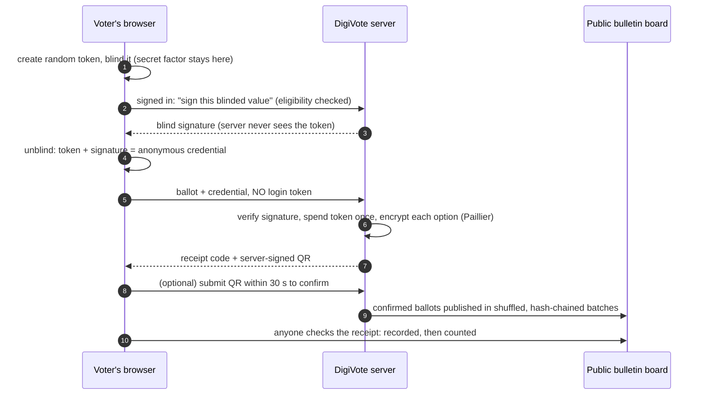

<div align="center">

# 🗳️ DigiVote

### Every vote secret. Every result provable.

**A verifiable, anonymous election platform for universities, companies, housing societies, NGOs and clubs.**

`Blind signatures` · `Homomorphic tally` · `Signed QR receipts` · `Hash-chained public bulletin board` · `Tamper-evident audit log`

    

</div>

---

## The idea

Most online voting asks you to trust somebody: the host, the admin, the database. DigiVote is built on the opposite
principle: **the system should not need your trust, because it can show its work.**

- Your ballot is **anonymous by construction**, not by promise: your browser gets a *blind-signed* credential, so the
  server proves you are eligible without ever seeing the token you vote with.
- Your vote is **encrypted** and tallied **homomorphically**: totals are decrypted, individual ballots never are.
- Your **receipt** lets you check, without logging in, that your ballot is on a public, hash-chained bulletin board and
  was counted in the result.
- Every administrative action lands in a **tamper-evident audit chain** that anyone with access can recompute from the
  first record, and so can the browser.

> *One eligible voter, one vote. Every accepted ballot independently checkable. Every action on the record.*

---

## What it does

| Stage | Capability |
| --- | --- |
| **Onboard** | Register an organization (typed: university, company, housing society, NGO, club). Invite members by one-time code, or let people **self sign-up** with encrypted identity details. Everyone gets a unique **DV number** (`DV-2026-00001`) to sign in with. |
| **Configure** | Per-election rules (plurality or approval counting, NOTA, selections, schedule, receipts, publication policy), validated by one rule engine. Optional **election banner**. |
| **Nominate** | Candidate applications, reviewer decisions with reasons, profiles (education, experience), manifestos with initiatives that **freeze when voting opens**, photos, PDFs, video. |
| **Vote** | Blind-signed anonymous credential → encrypted ballot sent **without a login token** → receipt. Optionally confirmed by a **signed QR within 30 seconds**. |
| **Verify** | Receipt code or QR → public bulletin board → "recorded" → "included in the tally". |
| **Count** | Paillier homomorphic tally, results hash recomputable in the browser, aggregation check by an auditor. |
| **Audit** | Hash-chained audit log, security events, integrity dashboard, **Election Trust Dashboard** with live checks. |
| **Govern** | Per-organization security policy (lockout, session length, mixed-case passwords), admin-initiated password recovery. |

---

## How a vote travels



**Why this holds together**

- **Anonymity.** Identity tables and ballot tables share no keys. Ballots carry no timestamp and no vote count, ids are
  random, and the audit log records ballot batches, not ballots, so timing cannot pair a voter with a ballot.
- **One vote.** One credential per voter (row lock + unique key) and one ballot per credential
  (`UNIQUE(election_id, token_hash)` under a per-election lock). Concurrent duplicates are tested.
- **Append-only evidence.** Ballots, ciphertexts, spent tokens, receipts, the audit log and the bulletin board are
  protected by database triggers.

---

## The signed QR receipt

A receipt that proves something, with nothing stored about *when* or *who*.

```
DIGIVOTE | QR1 | receipt code | election | issued-at | ballot commitment | HMAC signature
```

- **Stateless 30-second window.** The server checks its own signature and the time inside the QR. It stores no issue
  time, so confirming adds no timing signal.
- **Anonymous confirmation.** The submit endpoint refuses any request that carries a login token.
- **Unconfirmed means uncounted.** A pending ballot is kept out of the bulletin board, the tally and the aggregates by
  a marker row that holds neither time nor voter. Append-only tables are never touched.
- **Recast safely.** If the window passes, the voter proves the old credential and receives a fresh one; the old
  ballot is voided and can never be confirmed. A confirmed ballot can never be replaced.
- **Tamper-evident.** A changed code, election or signature is reported `INVALID`; a repeat is `DUPLICATE`; late is `EXPIRED`.

Off by default (`DIGIVOTE_QR_CONFIRMATION=true` turns it on). With it off, ballots are final when accepted.

---

## One origin, two modes

The frontend is a single-file prototype ([`web/index.html`](web/index.html)) that runs **standalone** from the browser
(demo mode) or, with one query parameter, against the real backend.

```
http://localhost:8080/            demo mode   no network, sample data, instant
http://localhost:8080/?mode=live  live mode   every screen backed by the Spring Boot API
```

| File | Role |
| --- | --- |
| `web/index.html` | the UI, unchanged apart from a few one-line seams |
| `web/api.js` | mode switch, JWT in `sessionStorage`, fetch with timeouts, error and field-error mapping |
| `web/live.js` | one clearly marked block per feature: elections, candidates, members, voting, audit, results, public site |
| `web/crypto.js` | voter-side blind signatures and key-transparency checks (matches the Java test vectors) |

**The browser does the cryptography that must stay private; the server does the rest.** The blinding has to happen on
the voter's device, otherwise the server could link voter and ballot. Signing, encryption, tallying, receipts and audit
hashing stay on the backend. The browser also **re-verifies** the evidence it is shown: it recomputes the audit chain,
every bulletin-board chain and the result hash with the backend's published formats.

---

## Trust you can check

| Check | Server | Your browser |
| --- | :---: | :---: |
| Audit chain from genesis | ✅ | ✅ recomputed |
| Bulletin board hash chain | ✅ | ✅ recomputed |
| Result hash | ✅ | ✅ recomputed |
| Credential key is the election's published key | | ✅ fingerprint + pinned |
| Ballot aggregates (re-multiplied ciphertexts) | ✅ | shows the result |

The **Election Trust Dashboard** shows six live checks (ballot accounting, duplicate prevention, bulletin chain,
receipts, result consistency, audit chain) with no invented "trust score": any failure is a failure.

---

## Quick start

Requires Java 21, Maven 3.9+ and MySQL 8 server binaries.

```bash
scripts/dev-mysql.sh start            # private MySQL on 127.0.0.1:3307 (Git Bash / Linux / macOS)
cd backend && mvn spring-boot:run     # API + web app on http://localhost:8080
```

Open **http://localhost:8080/?mode=live**, choose *Register organization*, and you are an owner with a DV number.
On Windows the script's socket check does not work; start `mysqld` directly (see
[docs/DEPLOYMENT.md](docs/DEPLOYMENT.md)).

Useful URLs: Swagger UI `/swagger-ui.html` · health `/actuator/health` · OpenAPI `/v3/api-docs`

| Setting | Purpose | Default |
| --- | --- | --- |
| `DIGIVOTE_PUBLIC_BASE_URL` | links in invitations and receipt QRs | `http://localhost:8080` |
| `DIGIVOTE_SIGNUP_ORG_SLUG` | organization the Sign up page joins people to (empty = disabled) | empty |
| `DIGIVOTE_QR_CONFIRMATION` | require signed-QR confirmation within 30 s | `false` |
| `DIGIVOTE_WEB_DIR` | folder served as the frontend | `../web` |

Configuration lives in a git-ignored `.env`; start from [`.env.example`](.env.example).

---

## Quality

```bash
cd backend && mvn test        # 136 tests: 68 unit + 68 integration on real MySQL
scripts/check-secrets.sh      # confirms no secrets are tracked
```

- **136 tests, 0 failures** on MySQL 8.4, including concurrency (duplicate ballots racing the close of voting), an
  anonymity attack simulation, database-trigger checks, and cross-language crypto vectors.
- **14 Flyway migrations** build the schema from nothing. Integration tests clean and re-migrate a dedicated test
  database every run.
- Browser-side checks for the live screens ran against a stand-in server; the
  [verification guide](docs/VERIFICATION_GUIDE.md) walks every flow against the real stack.

---

## Honest limits

Strong claims need honest edges, so these are stated plainly (full model in [docs/SECURITY_MODEL.md](docs/SECURITY_MODEL.md)):

- The server holds the tally key and decrypts the **totals**. There is no zero-knowledge proof of correct decryption;
  auditors verify the aggregation, not the decryption.
- The server briefly sees each selection in memory when it encrypts the ballot (never linked to an identity, never
  stored in plaintext).
- A voter who loses their credential before voting cannot get a second one (that would allow voting twice).
- Signed-QR confirmation cannot confirm a ballot cast in the last 30 seconds before voting closes.
- There is no email delivery: invitation and recovery codes are passed on by the person who creates them.

---

## Repository layout

```
backend/            Spring Boot API (com.digivote.*), Flyway migrations V1-V14, tests
web/                the HTML prototype + api.js / live.js / crypto.js, served by Spring Boot
frontend-react/     the earlier React app, kept for reference
scripts/            dev MySQL, end-to-end API run, secret scan, demo setup
docs/               architecture, database, security, API, tests, deployment, viva, verification guide
docker-compose.yml  optional MySQL + backend stack (build from the repo root)
.env.example        configuration placeholders (copy to .env, never commit .env)
```

## Documentation

| Document | Contents |
| --- | --- |
| [VERIFICATION_GUIDE.md](docs/VERIFICATION_GUIDE.md) | how to verify the prototype-to-backend wiring, flow by flow |
| [ARCHITECTURE.md](docs/ARCHITECTURE.md) | layers, packages, OOPS pillars, design patterns, diagrams |
| [DATABASE_DESIGN.md](docs/DATABASE_DESIGN.md) | ER diagram, tables, normalization, views, procedure, triggers |
| [SECURITY_MODEL.md](docs/SECURITY_MODEL.md) | threat model, anonymity, cryptography, keys, limitations |
| [API_DOCUMENTATION.md](docs/API_DOCUMENTATION.md) | endpoint reference and conventions |
| [TEST_REPORT.md](docs/TEST_REPORT.md) | earlier test report and edge-case mapping |
| [DEPLOYMENT.md](docs/DEPLOYMENT.md) | setup, environment variables, Firebase, hosting |
| [IMPLEMENTATION_STATUS.md](docs/IMPLEMENTATION_STATUS.md) | completed, partial and not-implemented items |
| [VIVA_PREPARATION.md](docs/VIVA_PREPARATION.md) | demo script and question bank |

---

<div align="center">

**DigiVote**: elections you can check instead of elections you have to believe.

*OOPS + DBMS Capstone Project*

</div>
