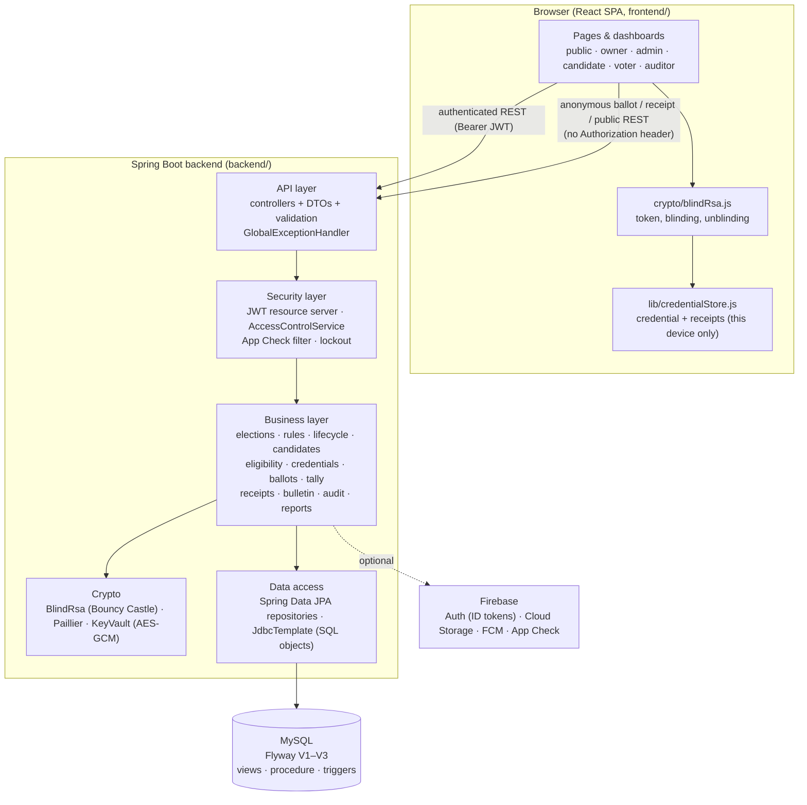
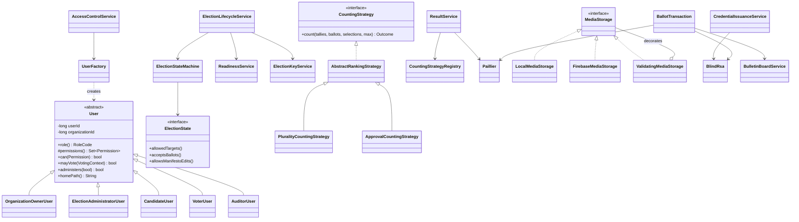
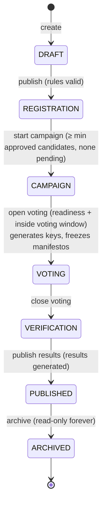

# DigiVote Architecture

DigiVote is a **modular monolith**: one Spring Boot 3.5 application (Java 21) on MySQL, with a React (Vite, Tailwind CSS) single-page application in front of it. Firebase services plug in optionally.

## 1. System architecture



Requests enter through the API layer, are authorized by the security layer, executed by business services, and persisted through repositories. Controllers stay thin: each delegates to one service call.

## 2. Code layout

| Package (`backend/src/main/java/com/digivote/…`) | Responsibility |
|---|---|
| `config` | Typed properties, security filter chain, OpenAPI, clock |
| `common` | `ApiException`, central `GlobalExceptionHandler`, paging, hashing |
| `auth` | Registration, login and lockout, invitation activation, Firebase login, JWT issuing |
| `user`, `organization` | Accounts, organizations, memberships, the five roles |
| `access` | Role class hierarchy (`User` and subclasses), `UserFactory`, `AccessControlService` (authoritative authorization) |
| `election` | Election aggregate, rules, readiness; `election.rules` (rule engine), `election.state` (state machine + lifecycle service) |
| `candidate` | Applications, candidates, manifestos, media; `candidate.storage` (storage abstraction + validating decorator) |
| `voting` | Identity side (eligible voters, credentials) and anonymous side (ballots, votes, spent tokens, receipts, bulletin entries), credential issuance, ballot transaction |
| `crypto` | `Paillier`, `BlindRsa`, `KeyVault`, secure random tokens |
| `verification` | Bulletin board chain, receipt verification, public endpoints |
| `result` | Tally service and counting strategies |
| `audit` | Hash-chained audit log, integrity verification, security events |
| `notification` | In-app notifications, FCM push, lifecycle observer |
| `report` | Report snapshots, Election Trust Dashboard |
| `firebase` | Firebase Admin initialization, ID-token verification, App Check filter |

The frontend (`frontend/src`) mirrors this: `api/` (axios clients and endpoint functions), `auth/` (session context), `components/` (UI kit, layouts, charts), `pages/{public,owner,admin,candidate,voter,auditor,shared}`, `crypto/` and `lib/`.

## 3. Object-oriented design

### The four pillars

| Pillar | Where | How |
|---|---|---|
| **Encapsulation** | `user/UserAccount.java`, `election/Election.java`, `candidate/Manifesto.java`, `result/ElectionResult.java`, `crypto/KeyVault.java` | Password hash has no public setter and is never serialized; `Election` status changes only through package-private `applyTransition` used by the lifecycle service; frozen manifestos and published results refuse every mutator; master key never leaves `KeyVault`. |
| **Inheritance** | `access/User.java` → `OrganizationOwnerUser`, `ElectionAdministratorUser`, `CandidateUser`, `VoterUser`, `AuditorUser`; `result/AbstractRankingStrategy` → `PluralityCountingStrategy`, `ApprovalCountingStrategy` | Shared identity state and template behaviour live in the abstract parent. |
| **Polymorphism** | `User.mayVote(...)`, `User.administers(...)`, `homePath()`, `dashboardSections()`; `CountingStrategy.count(...)`; `ElectionState` implementations | `CandidateUser` tightens voting policy, `AuditorUser` never votes, owners administer every election, admins only assigned ones. Tallying calls the interface; the configured method decides the algorithm. |
| **Abstraction** | `CountingStrategy`, `ElectionState`, `MediaStorage`, repositories, `BlindRsa`/`Paillier` facades | Services depend on interfaces; storage provider, counting method and crypto internals are hidden behind them. |

### Design patterns (exact files)

| Pattern | Files | Real behaviour |
|---|---|---|
| Singleton | Spring-managed beans; HikariCP `DataSource` configured in `application.yml` (`spring.datasource.hikari`) | One connection pool for the whole application; no hand-rolled connection manager. |
| Factory | `access/UserFactory.java` | Builds the role-specific `User` subclass from an account and membership on every request. |
| Observer | `election/state/ElectionLifecycleEvent.java`, `candidate/ManifestoFreezeListener.java`, `notification/ElectionNotificationListener.java` | Lifecycle transitions publish an event; one listener freezes manifestos inside the transaction, another notifies people after commit. |
| Strategy | `result/CountingStrategy.java`, `PluralityCountingStrategy.java`, `ApprovalCountingStrategy.java`, `CountingStrategyRegistry.java` | The election's persisted `counting_method` picks the algorithm. |
| State | `election/state/ElectionState.java`, `LifecycleStates.java`, `ElectionStateMachine.java`, `ElectionLifecycleService.java` | Each state declares allowed targets and which operations are open (applications, manifesto edits, ballots, result generation). |
| Template method | `result/AbstractRankingStrategy.java` | Shared ranking and tie policy; subclasses validate their own totals. |
| Decorator | `candidate/storage/ValidatingMediaStorage.java` | Wraps local or Firebase storage with content-type and magic-byte validation. |

### Class diagram (core)



## 4. Election lifecycle (state diagram)



There is no generic status update endpoint: `POST /api/elections/{id}/transitions` is the only way to move an election, and every accepted transition is written to `election_state_transitions` and the audit chain.

## 5. Vote casting (sequence)

```mermaid
sequenceDiagram
    autonumber
    actor V as Voter browser
    participant API as DigiVote API
    participant ID as Identity tables
    participant AN as Anonymous tables
    V->>API: GET /eligibility (Bearer JWT)
    API->>ID: eligible_voters + role policy + window
    V->>API: GET /credential-key
    Note over V: t = random 32 bytes, m = FDH(t)<br/>r random, m' = m·r^e mod n
    V->>API: POST /credentials {m'} (Bearer JWT)
    API->>ID: lock eligible_voters row, one credential per voter
    API-->>V: s' = m'^d mod n
    Note over V: s = s'·r^-1 mod n, verify s^e = FDH(t)
    V->>API: GET /ballot (Bearer JWT)
    Note over V: select, confirm
    V->>API: POST /public/elections/{id}/ballots {t, s, selections, nonce}<br/>(NO Authorization header)
    API->>AN: lock election keys row (serialize)
    API->>AN: verify s, check spent token, validate selections
    API->>AN: Paillier-encrypt one-hot vector, insert ballot + votes,<br/>spent token (UNIQUE), receipt hash (random ids, no timestamps)
    API->>AN: if >= batch size ballots wait: append them to the bulletin<br/>board in shuffled order + one BALLOTS_PUBLISHED batch event
    API-->>V: receipt code + QR (no identity, no choice; position pending until its batch is published)
```

All anonymous-side writes for one ballot happen in a single database transaction; a failure at any step rolls everything back and the credential stays spendable. There is no per-ballot audit event (it would sit next to the voter's `CREDENTIAL_ISSUED` event). Closing voting publishes every remaining ballot as a final shuffled batch in the same transaction as the status change.

Lock order: ballot submission and voting closure both take the election's `election_keys` row first and the `elections` row second (ballot inserts reach the election row through foreign keys), and closure runs at READ COMMITTED so it sees every ballot committed while it waited for the lock. Ballots accepted before the V4 migration keep their original per-ballot audit events, sequential ids and minute timestamps.

## 6. Authentication and authorization flow

```mermaid
flowchart LR
    A[Password login<br/>BCrypt + lockout] --> J[DigiVote JWT<br/>HS256, sub = user id]
    F[Firebase ID token<br/>verified by Admin SDK] -->|linked by verified email| J
    I[Invitation code<br/>SHA-256 stored] --> J
    J --> R[Resource server validates signature/expiry]
    R --> AC[AccessControlService]
    AC -->|loads membership from DB| U[User subclass via UserFactory]
    U -->|can(permission)?| P{Permission}
    P -->|election op| O{Operates this election?}
    O --> S[Service executes]
    AC -.non-member.-> N[404 + CROSS_ORG_ACCESS event]
    P -.denied.-> D[403 + AUTHORIZATION_DENIED event]
```

The token carries no roles. Roles are resolved from current memberships on every request, so suspensions and role changes apply immediately. Frontend route guards only shape the UI.
