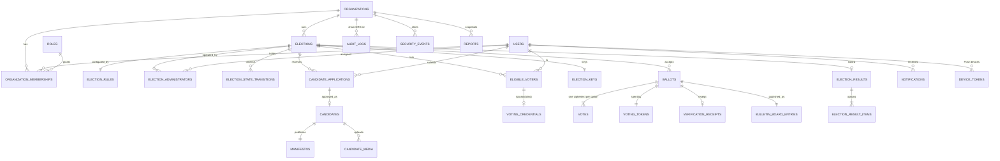

# DigiVote Database Design

MySQL 8+ (developed and tested on MySQL 9.7). Schema is created only by Flyway migrations in `backend/src/main/resources/db/migration`:

| Migration | Contents |
|---|---|
| `V1__core_schema.sql` | 28 tables with primary keys, foreign keys, unique and check constraints, indexes |
| `V2__views_procedures_triggers.sql` | 2 views, 1 stored procedure, 16 triggers |
| `V3__reference_data.sql` | The five roles (no user accounts or credentials) |
| `V4__anonymity_hardening.sql` | Ballot/receipt timing and selection-count columns nullable (not written for new ballots); `election_keys` made immutable by triggers |

Migrations run automatically on backend start and were verified on a fresh database (integration test `DatabaseIT.migrationsCreateTheSchemaOnAFreshDatabase`).

## 1. ER diagram

**There is no relationship between the identity side (`USERS`, `ELIGIBLE_VOTERS`, `VOTING_CREDENTIALS`) and the anonymous side (`BALLOTS`, `VOTES`, `VOTING_TOKENS`, `VERIFICATION_RECEIPTS`, `BULLETIN_BOARD_ENTRIES`).** This is checked by `DatabaseIT.anonymousTablesHoldNoIdentityColumns`, which asserts that none of the anonymous tables has an identity column or a foreign key to an identity table.

## 2. Tables

| Table | Purpose | Key constraints |
|---|---|---|
| `roles` | The five role codes (reference data) | PK `code` |
| `organizations` | Tenant workspaces, branding, password and lockout policy | UQ `slug`; CHECK status, colour format, policy ranges |
| `users` | Accounts (identity) | UQ `email`, UQ `firebase_uid`; CHECK status, failed count ≥ 0 |
| `organization_memberships` | User × organization × role | UQ (`organization_id`,`user_id`); FK role; CHECK status; activation code stored as SHA-256 |
| `elections` | Election aggregate | FK organization; CHECK status in the 7 lifecycle states; optimistic `version` |
| `election_rules` | Persisted rule set (1:1) | CHECK max selections 1–50, counting method, publication policy, voting/campaign windows ordered |
| `election_administrators` | Admins assigned to an election | PK (`election_id`,`user_id`) |
| `election_state_transitions` | Lifecycle timeline | FK election, actor |
| `candidate_applications` | Application workflow | UQ (`election_id`,`user_id`); CHECK status |
| `candidates` | Approved contestants on the ballot | UQ application, UQ (`election_id`,`user_id`), UQ (`election_id`,`ballot_position`) |
| `manifestos` | Vision/mission/goals/schemes, frozen flag | UQ candidate |
| `candidate_media` | Photo, manifesto PDF, poster, video metadata + SHA-256 | CHECK media type, provider, size > 0 |
| `eligible_voters` | Voter list (identity side) | UQ (`election_id`,`user_id`) |
| `voting_credentials` | One blind-signature issuance per eligible voter | **UQ `eligible_voter_id`** (one credential per voter) |
| `election_keys` | RSA + Paillier public keys, AES-GCM-sealed private keys | PK election |
| `ballots` | Accepted ballots (anonymous; random id; no time or selection count since V4) | UQ commitment; CHECK selection count ≥ 1 |
| `votes` | One Paillier ciphertext per ballot option | UQ (`ballot_id`,`option_index`) |
| `voting_tokens` | Spent anonymous tokens | **UQ (`election_id`,`token_hash`)**: database-level one-vote guarantee; UQ ballot |
| `verification_receipts` | SHA-256 of receipt code → ballot | UQ code hash, UQ ballot |
| `bulletin_board_entries` | Hash-chained public record | UQ (`election_id`,`seq`), UQ ballot |
| `election_results`, `election_result_items` | Tally outcome and per-option totals + aggregate ciphertexts | UQ election; CHECK counts ≥ 0 |
| `audit_logs`, `audit_chain_heads` | Append-only hash chain per organization | UQ (`chain_key`,`seq`), UQ event id |
| `security_events` | Authentication/authorization/abuse events | CHECK severity |
| `notifications`, `device_tokens` | In-app notifications, FCM registrations | UQ device token |
| `reports` | Report snapshots with content hash | CHECK report type |

### Normalization

All tables are in 3NF: every non-key attribute depends on the whole key and nothing but the key. Role names live only in `roles`; election configuration lives in `election_rules` (1:1, separated so rule changes are audited independently of election details); per-option ciphertexts are a child table (`votes`) instead of repeating columns; result items are a child of results. Derived figures (turnout, counts) are computed by the view and procedure, not stored.

### Deletion and archival policy

* Every foreign key uses `ON DELETE RESTRICT` (except nullable references such as `invited_by`, which use `SET NULL`), so nothing cascades away election history.
* Members are never deleted; their membership status becomes `REMOVED`. Voters are removed from a list by status `REMOVED`, and only before a credential is issued.
* Ballots, votes, spent tokens, receipts, bulletin entries and audit logs cannot be updated or deleted (triggers below).
* Archived elections are read-only (trigger) and stay queryable for auditors.

## 3. SQL objects

### Views

* `v_election_participation`: eligible voters, credentials issued and accepted ballots per election. Each figure is a separate sub-query count, so identity rows and ballot rows are never joined.
* `v_published_results`: results joined with items **only when status = PUBLISHED**; generated-but-unpublished results never appear.

### Stored procedure

`sp_election_participation(IN p_election_id)` returns `eligible_voters`, `credentials_issued`, `accepted_ballots`, `turnout_percent` and an alarm flag `ballots_exceed_credentials`. It is called by `ReportService.participation` (`GET /api/elections/{id}/participation`, the Voting progress tab and participation reports).

### Triggers

| Trigger | Protects |
|---|---|
| `trg_audit_logs_no_update`, `trg_audit_logs_no_delete` | Audit history is append-only |
| `trg_ballots_no_update`, `trg_ballots_no_delete` | Accepted ballots |
| `trg_votes_no_update`, `trg_votes_no_delete` | Ballot ciphertexts |
| `trg_bulletin_no_update`, `trg_bulletin_no_delete` | Bulletin board |
| `trg_receipts_no_update`, `trg_receipts_no_delete` | Receipts |
| `trg_tokens_no_delete` | Spent tokens (deleting one would re-enable a credential) |
| `trg_results_published_immutable`, `trg_result_items_published_no_update`, `trg_result_items_published_no_delete` | Published results |
| `trg_manifesto_frozen` | Frozen manifestos |
| `trg_election_archived_readonly` | Archived elections |

All are exercised in `DatabaseIT.triggersProtectBallotsAuditHistoryResultsManifestosAndArchives`.

## 4. Transactions and concurrency

| Operation | Mechanism |
|---|---|
| Ballot acceptance (`BallotTransaction.cast`) | One `READ COMMITTED` transaction; `SELECT … FOR UPDATE` on the election's `election_keys` row serializes ballots per election; the election status is re-read under the lock; spent-token check under the lock; UNIQUE(`election_id`,`token_hash`) as the final guard; ballot, votes, token and receipt (random ids) commit together or not at all; when enough ballots are waiting, a shuffled bulletin batch is appended in the same transaction. Closing voting takes the same lock and publishes the final shuffled batch. |
| Credential issuance | `SELECT … FOR UPDATE` on the voter's `eligible_voters` row; UNIQUE(`eligible_voter_id`) in `voting_credentials`. |
| Lifecycle transitions | `SELECT … FOR UPDATE` on the election row; keys generated and manifestos frozen in the same transaction as the move to VOTING. |
| Audit append | `SELECT … FOR UPDATE` on `audit_chain_heads` row so sequence numbers never fork. (The head is locked before any insert: an earlier `INSERT IGNORE`-first version deadlocked under concurrent duplicate ballots, found and fixed by `VotingWorkflowIT.concurrentDuplicateSubmissionsAcceptExactlyOneBallot`.) |
| Security events / rejected-ballot audit | `REQUIRES_NEW` transactions so they persist when the triggering request fails. |
| Election edits | JPA optimistic locking (`version`) returns 409 on concurrent modification. |

## 5. Database tests

`backend/src/test/java/com/digivote/integration/DatabaseIT.java` (real MySQL): fresh-database migration, anonymity of the schema, all trigger classes, check and unique constraints, view and procedure outputs. The voting and security integration suites additionally verify transactional rollback (`failedBallotPersistenceLeavesNoPartialStateAndRetrySucceeds`) and concurrency (`concurrentDuplicateSubmissionsAcceptExactlyOneBallot`).
